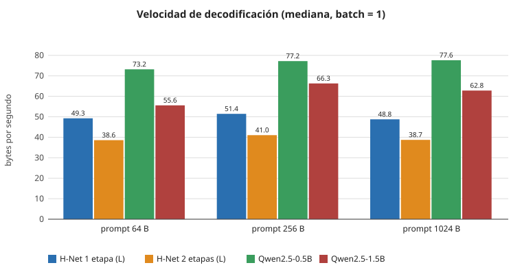
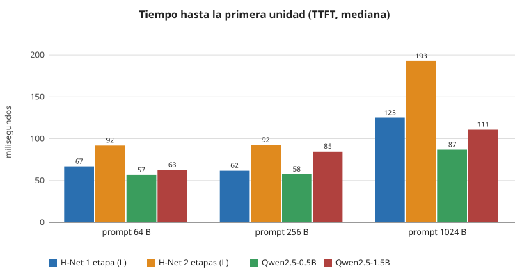
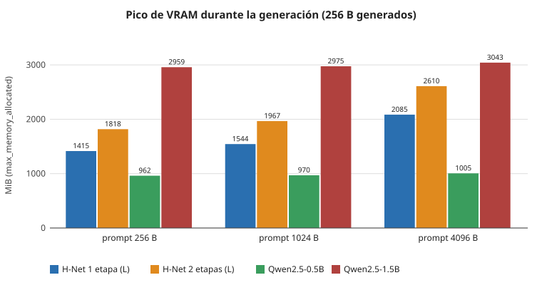
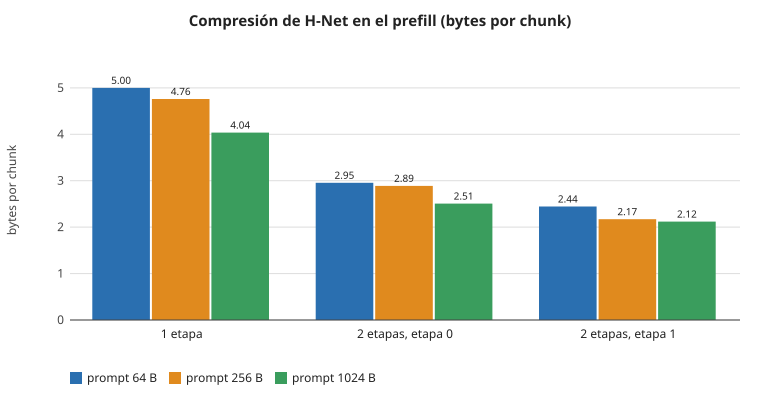

# INICIO (versión v1)

> **Versión v1 (primera versión funcional).** Este documento describe el estado del proyecto en el commit `8b1e2a3` más los documentos de esta versión. El motor es un prototipo de referencia con batch = 1; las secciones 8 y 9 recogen sus límites y el trabajo futuro.

## Contenido

1. El TFG en resumen
2. Fundamentos: H-Net y *dynamic chunking*
3. Qué contiene la v1
4. Estructura del código y relación entre módulos
5. Ejecución en un equipo ajeno
6. Batería de pruebas
7. Resultados de la v1
8. Limitaciones conocidas de la v1
9. Optimizaciones y pasos futuros

---

## 1. El TFG en resumen

Trabajo Fin de Grado del Grado en Ingeniería de Computadores (URJC). El objeto de estudio es **H-Net**, un modelo de lenguaje sin tokenizador que opera directamente sobre bytes (`vocab_size = 256`) y comprime la secuencia mediante un mecanismo aprendido de *dynamic chunking*. El código del modelo procede del repositorio oficial [goombalab/hnet](https://github.com/goombalab/hnet) con correcciones mínimas.

La aportación del trabajo es de **ingeniería de sistemas y evaluación experimental**, no de entrenamiento. Se construye un motor de inferencia en GPU que:

- unifica H-Net y un baseline Transformer denso (**Qwen2.5**) bajo una interfaz común (`BaseModelWrapper`), de modo que ambos se ejecutan con el mismo bucle de generación, el mismo muestreo y las mismas mediciones;
- mide pico de VRAM, latencia y throughput de forma reproducible;
- gestiona el estado de un modelo híbrido (estados recurrentes SSM y caché KV de atención);
- se expone como API REST con una página web de demostración.

## 2. Fundamentos: H-Net y *dynamic chunking*

H-Net procesa la secuencia de bytes en una jerarquía de etapas:

```
bytes (B, L) -> Embedding(256 -> d)
  etapa 0:  encoder (Mamba-2 + atención)
            routing_module -> boundary_mask, boundary_prob
            chunk_layer    -> secuencia de K chunks, K < L
            red principal  -> etapa 1 (recursiva) o bloque isotrópico
            dechunk_layer  -> vuelta a longitud L (suavizado EMA)
            residual       -> suma ponderada con la salida del encoder
            decoder (Mamba-2 + atención)
  lm_head -> logits (B, L, 256)
```

- El **routing** estima, a partir de la disimilitud coseno entre estados adyacentes, la probabilidad de que un byte inicie un nuevo *chunk*. El primer byte siempre inicia uno.
- La **red principal** trabaja solo a resolución de chunk, por lo que procesa menos posiciones que bytes recibe el modelo. La relación bytes/chunks es la **tasa de compresión**.
- La generación incremental mantiene un `HNetState` por etapa: estados SSM, caché KV de atención y estado del routing y del dechunk. La función `step()` del código oficial solo admite batch = 1, porque cada secuencia corta sus chunks en posiciones distintas y la red interna avanza a ritmos distintos.
- Los checkpoints preentrenados proceden de la colección [cartesia-ai/h-net](https://huggingface.co/collections/cartesia-ai/h-net). Con pesos aleatorios no se puede medir compresión, porque el routing no ha aprendido fronteras.

Como las unidades de H-Net son bytes y las de Qwen son tokens BPE, la comparación justa se expresa en **bytes UTF-8 por segundo**, informando además de unidades nativas por segundo y de bytes por unidad.

## 3. Qué contiene la v1

| Componente | Estado en la v1 |
|---|---|
| Carga de checkpoints H-Net (`hnet_1stage_L`, `hnet_2stage_L`) y Qwen2.5-0.5B / 1.5B | Implementado |
| Generación incremental con muestreo (temperatura, top-k, top-p, penalización por repetición) y condiciones de parada | Implementado |
| Métricas por petición (TTFT, bytes/s, unidades/s, bytes por unidad, compresión por etapa) | Implementado |
| Servicio de inferencia (`engine.py`): modelo residente, cola FIFO, streaming, comparación y segmentación | Implementado (batch = 1) |
| API REST (FastAPI) y página web de demostración | Implementado |
| Benchmarks de throughput y de pico de memoria con calentamiento obligatorio | Implementado |
| Pruebas unitarias y de coherencia (`tests/test_engine.py`, `tests/test_api.py`) | Implementado |
| Batching de varias secuencias (`batch_manager.py`) | Pendiente (archivo vacío) |
| Caché propia (`kv_cache.py`) | Pendiente (archivo vacío) |
| Pruebas del módulo de chunking (`tests/test_dc.py`) | Pendiente (archivo vacío) |
| Imagen Docker (`Dockerfile`) | Pendiente (archivo vacío) |

## 4. Estructura del código y relación entre módulos

```
src/
  api/
    app.py, schemas.py        API REST (FastAPI) y arranque con argumentos
    static/index.html         demostración web (HTML/JS sin compilación)
  core/
    engine.py                 InferenceEngine: catálogo, modelo residente, cola, streaming
    batch_manager.py          (vacío) batching futuro
    kv_cache.py               (vacío) caché futura
  models/
    wrappers/
      base.py                 BaseModelWrapper, GenerationConfig, GenerationResult
      hnet_wrapper.py         HNetWrapper (checkpoints oficiales)
      qwen_wrapper.py         QwenWrapper (baseline, arquitectura qwen2)
    architectures/
      hnet/                   código de H-Net con correcciones marcadas con "#TFG:"
      hnet_compat.py          adaptadores de compatibilidad de versiones
  utils/metrics.py            semillas, entorno, PeakMemory, resúmenes, JSON
scripts/                      benchmarks, generación de figuras, prueba de humo
configs/hnet/*.json           configuraciones oficiales de H-Net
configs/benchmarks/prompt.txt texto de referencia de los benchmarks
tests/                        pruebas
docs/figuras/                 figuras SVG de esta documentación
```

Relación entre capas (de arriba abajo):

1. **API** (`src/api/app.py`) traduce peticiones HTTP a llamadas al motor y devuelve JSON o eventos SSE.
2. **Motor** (`src/core/engine.py`) mantiene un modelo residente, serializa las peticiones en un único hilo de GPU (batch = 1) y ofrece `generate`, `stream`, `compare`, `segment` y `status`.
3. **Wrappers** (`src/models/wrappers/`) implementan la interfaz `BaseModelWrapper`: `load`, `encode`, `allocate_state`, `prefill`, `decode_step`, etc. El bucle de generación, el muestreo y los tiempos (eventos CUDA, sin sincronizaciones añadidas) residen en `base.py` y son comunes a todos los modelos.
4. **Arquitecturas** contienen el código de H-Net y los **shims** de `hnet_compat.py`, que corrigen incompatibilidades entre las versiones fijadas de `triton`, `mamba-ssm` y `causal-conv1d` sin modificar las librerías. Este módulo debe importarse antes que cualquier módulo de `hnet`; los wrappers ya lo hacen.
5. **Benchmarks** (`scripts/eval_*.py`) usan `src/utils/metrics.py` y los wrappers directamente, sin pasar por el motor ni la API, para no incluir la cola en las medidas.

## 5. Ejecución en un equipo ajeno

### 5.1 Requisitos

- GPU NVIDIA con arquitectura Ampere o posterior (bf16) y al menos 8 GB de VRAM (el modelo mayor, Qwen2.5-1.5B, necesita unos 3 GiB; H-Net 2 etapas, unos 2,6 GiB con 4 KB de prompt).
- Linux o WSL 2 con Ubuntu 24.04, controlador NVIDIA compatible con CUDA 12.x, y Python 3.12.
- CUDA Toolkit 12.x (`nvcc`) y compilador (`build-essential`) para compilar `flash-attn`, `mamba-ssm` y `causal-conv1d`. La compilación puede tardar decenas de minutos.
- Conexión a Internet en la primera ejecución: los pesos se descargan de Hugging Face (H-Net 1 etapa ≈ 2,7 GB, 2 etapas ≈ 3,5 GB, Qwen2.5-0.5B ≈ 1 GB, Qwen2.5-1.5B ≈ 3 GB).
- Si la GPU es Ada o Ampere conviene fijar `TORCH_CUDA_ARCH_LIST` (`8.9` o `8.6`) antes de compilar.

### 5.2 Instalación

```bash
git clone https://github.com/perezllanosnicolas/hnet_inference_engine.git
cd hnet_inference_engine
python3.12 -m venv .venv
export TORCH_CUDA_ARCH_LIST="8.9"          # 8.6 para Ampere
```

El `torch` debe estar instalado antes de compilar las extensiones. La instalación se realiza **siempre sin resolución de dependencias**: pip tiende a sustituir PyTorch por una compilación ligada a CUDA 13 que inutiliza el entorno.

```bash
.venv/bin/pip install --no-deps \
  torch==2.5.1+cu121 torchvision==0.20.1+cu121 torchaudio==2.5.1+cu121 triton==3.1.0 \
  --index-url https://download.pytorch.org/whl/cu121
.venv/bin/pip install --no-deps --no-build-isolation -r requirements.txt
```

No se debe actualizar ninguna dependencia fijada. Verificación:

```bash
.venv/bin/pip check
.venv/bin/python scripts/test_hnet_architecture.py
```

La prueba de humo construye un H-Net pequeño con pesos aleatorios y debe terminar mostrando los logits con forma `[1, 40, 256]`.

### 5.3 Comprobación con las pruebas

```bash
.venv/bin/python -m unittest tests.test_engine tests.test_api -v
```

Las pruebas que dependen de modelos reales (`hnet_1stage_L`, `Qwen2.5-0.5B`) se omiten si estos no están en la caché de Hugging Face. Para descargarlos de antemano:

```bash
.venv/bin/python -c "from huggingface_hub import hf_hub_download as d; d('cartesia-ai/hnet_1stage_L','hnet_1stage_L.pt')"
```

### 5.4 Arranque del servicio y la demostración

```bash
.venv/bin/python -m src.api.app --model hnet_1stage_L --allow-download --port 8000
```

La página está en <http://127.0.0.1:8000> y la documentación interactiva de la API, en <http://127.0.0.1:8000/docs>. Para acceder desde otro equipo de la red se añade `--host 0.0.0.0`. El servicio no incorpora autenticación, por lo que no debe exponerse a redes no confiables.

### 5.5 Reproducción de los benchmarks

Los benchmarks deben ejecutarse con la GPU sin otra carga (cerrar navegadores y otros procesos con CUDA) y, en portátiles, con la alimentación conectada y el perfil de máximo rendimiento.

```bash
# Throughput y latencia
.venv/bin/python scripts/eval_throughput.py \
  --models hnet_1stage_L hnet_2stage_L Qwen2.5-0.5B Qwen2.5-1.5B \
  --prompt-bytes 64 256 1024 --gen-bytes 256 --repeats 5 --warmup 2 --profile-shim

# Pico de memoria
.venv/bin/python scripts/eval_memory_peak.py \
  --models hnet_1stage_L hnet_2stage_L Qwen2.5-0.5B Qwen2.5-1.5B \
  --prompt-bytes 256 1024 4096 --gen-bytes 256

# Figuras a partir de los JSON generados en results/
.venv/bin/python scripts/generar_figuras.py \
  --throughput results/throughput_<fecha>.json --memoria results/memory_peak_<fecha>.json
```

Cada JSON incluye el entorno (GPU, driver, versiones y commit), de modo que los resultados de varios equipos sean comparables. Para aportar resultados de otro equipo basta con enviar los archivos de `results/`. Las cifras absolutas dependen de la GPU y, en la decodificación de H-Net, también de la CPU (ver sección 8).

### 5.6 Problemas frecuentes

| Síntoma | Solución |
|---|---|
| `undefined symbol: ncclCommResume` | pip actualizó torch a CUDA 13; repetir la instalación de torch del apartado 5.2 con `--force-reinstall --no-deps` |
| `ModuleNotFoundError: No module named 'torch'` al compilar | usar `--no-build-isolation` y haber instalado torch antes |
| `cannot import name 'GreedySearchDecoderOnlyOutput'` | `transformers` distinto de 4.44.2 |
| `assert qkv.dtype in [float16, bfloat16]` | el modelo está en fp32; usar bf16 |
| Primera generación de más de 10 s | compilación de kernels Triton; es normal y el calentamiento la absorbe |

## 6. Batería de pruebas

La batería se diseña para que las medidas sean reproducibles y comparables entre modelos con unidades distintas.

**Condiciones comunes**

- Batch = 1, decodificación voraz, precisión bf16, semilla fija (0), `ignore_eos` activado para que todas las repeticiones generen la misma cantidad.
- Calentamiento obligatorio con la misma configuración que la medición (absorbe la compilación Triton y la inicialización de CUDA).
- Tiempos medidos con eventos CUDA dentro de `generate`, sin sincronizaciones adicionales.
- Entorno registrado en cada JSON: GPU, driver, versiones de librerías, commit y estado del árbol de trabajo.
- Prompt: capítulo 1 de *Pride and Prejudice* (dominio público, `configs/benchmarks/prompt.txt`), recortado a N bytes sin partir caracteres.

**Modelos**: `hnet_1stage_L` (679 M parámetros), `hnet_2stage_L` (874 M), `Qwen2.5-0.5B` (494 M) y `Qwen2.5-1.5B` (1,54 B). Los dos Qwen acotan a H-Net por debajo y por encima en tamaño.

| Prueba | Script | Variables | Métricas |
|---|---|---|---|
| Throughput y latencia | `eval_throughput.py` | prompt de 64, 256 y 1024 B; 256 B generados; 5 repeticiones | TTFT, prefill (unidades/s), decodificación (bytes/s y unidades/s), bytes por unidad, compresión por etapa de H-Net, coste del shim de alineación; media, desviación, mediana, p5 y p95 |
| Pico de memoria | `eval_memory_peak.py` | prompt de 256, 1024 y 4096 B; 256 B generados | memoria de carga (parámetros y buffers), tamaño del estado, pico de prefill y pico de generación completa (`max_memory_allocated`, con `max_memory_reserved` como referencia) |
| Coherencia numérica | `tests/test_engine.py` | modelo aleatorio y `hnet_1stage_L` | prefill + `step` frente al forward completo: fronteras idénticas, error acotado, argmax coincidente |
| Muestreo y parada | `tests/test_engine.py` | modelo ficticio en CPU | temperatura, top-k, top-p, secuencias de parada |
| Baseline Qwen | `tests/test_engine.py` | Qwen2.5-0.5B | tabla de bytes por token, igualdad con `model.generate`, tablas RoPE compactas bit a bit idénticas |
| Servicio y API | `tests/test_api.py` | motor con wrapper guionizado | cola, streaming SSE, comparación, segmentación y errores |
| Humo de arquitectura | `scripts/test_hnet_architecture.py` | H-Net pequeño aleatorio | el forward completo se ejecuta en GPU con las versiones fijadas |

Estado de las pruebas en la v1: 40 pruebas en `test_engine.py` (unos 66 s) y 22 en `test_api.py`.

## 7. Resultados de la v1

Equipo de medida: NVIDIA GeForce RTX 4060 Laptop (8 GB, sm_89), WSL 2, PyTorch 2.5.1+cu121, bf16, batch = 1, decodificación voraz. Datos: `results/throughput_20261018-134404.json` y `results/memory_peak_20261018-141542.json`. Las figuras se generan con `scripts/generar_figuras.py`.

### 7.1 Decodificación



| Modelo | 64 B | 256 B | 1024 B | Unidades/s (1024 B) | Bytes por unidad |
|---|---|---|---|---|---|
| H-Net 1 etapa (L) | 49,3 | 51,4 | 48,8 | 48,8 byte/s | 1,0 |
| H-Net 2 etapas (L) | 38,6 | 41,0 | 38,7 | 38,7 byte/s | 1,0 |
| Qwen2.5-0.5B | 73,2 | 77,2 | 77,6 | 18,4 tok/s | 4,2 |
| Qwen2.5-1.5B | 55,6 | 66,3 | 62,8 | 15,9 tok/s | 4,0 |

Medianas en bytes/s. En esta versión Qwen decodifica más bytes por segundo que H-Net porque emite unos 4 bytes por paso, mientras que H-Net emite uno. La decodificación de H-Net está limitada por la CPU (lanzamiento de kernels y sincronizaciones del chunking), no por la GPU; es el principal punto de mejora (sección 9).

### 7.2 Tiempo hasta la primera unidad (TTFT)



El TTFT crece con la longitud del prompt en todos los modelos; con 1 KB es de 125 ms (H-Net 1 etapa), 193 ms (H-Net 2 etapas), 87 ms (Qwen-0.5B) y 111 ms (Qwen-1.5B).

### 7.3 Memoria



| Modelo | Pesos (MiB) | Pico con 256 B | Pico con 1024 B | Pico con 4096 B |
|---|---|---|---|---|
| H-Net 1 etapa (L) | 1311 | 1415 | 1544 | 2085 |
| H-Net 2 etapas (L) | 1689 | 1818 | 1967 | 2610 |
| Qwen2.5-0.5B | 951 | 962 | 970 | 1005 |
| Qwen2.5-1.5B | 2945 | 2959 | 2975 | 3043 |

El pico de H-Net crece con el prompt porque `allocate_inference_cache` reserva caché KV para la longitud máxima en todas las etapas (unos 576 MiB de estado con 4 KB en `hnet_1stage_L`), mientras que Qwen usa atención con GQA y su caché es mucho menor. Con las tablas RoPE de Qwen recortadas (decisión 005), los buffers de Qwen-0.5B pasan de 192 MiB a 0,07 MiB y los de Qwen-1.5B de 1792 MiB a 0,13 MiB.

### 7.4 Compresión de H-Net



Con checkpoints preentrenados, `hnet_1stage_L` alcanza entre 4,0 y 5,0 bytes por chunk en el prefill y `hnet_2stage_L` entre 2,5 y 3,0 en la primera etapa y entre 2,1 y 2,4 en la segunda. La compresión medida disminuye al aumentar la longitud del prompt; la causa no se ha analizado en la v1.

### 7.5 Coste del shim de alineación

Con los checkpoints oficiales no se produce ninguna copia de alineación (0 copias en 8 llamadas de `causal_conv1d_fwd`), porque el ancho de las proyecciones es múltiplo de 8. Solo se copia en configuraciones pequeñas como la de la prueba de humo (0,3 ms con L = 512). La decodificación usa `causal_conv1d_update` y nunca pasa por el parche.

## 8. Limitaciones conocidas de la v1

- **Batch = 1.** El motor atiende una petición cada vez; la cola es FIFO. `HNetForCausalLM.step()` solo admite una secuencia.
- **Decodificación de H-Net limitada por CPU:** unos 95 lanzamientos de kernel por paso, con `LayerNormFn` de Triton (~260 µs de CPU por llamada) y `causal_conv1d_update` (~220 µs) como mayores costes, y sincronizaciones en `nonzero`/`index` del chunking.
- **Caché de H-Net sobredimensionada**: se reserva para `max_seqlen` en todas las etapas.
- **Una sola GPU y un solo equipo de medida** (portátil, WSL 2): las cifras absolutas no son extrapolables y presentan variabilidad entre ejecuciones.
- **Prompts mayores de 4,4 KB** repiten el texto de referencia (indicado como `prompt_repeated` en el JSON).
- **Sin autenticación ni límites por usuario** en la API.
- **Versiones fijadas antiguas** (PyTorch 2.5.1, Triton 3.1.0) compensadas con shims; su actualización queda fuera del alcance de la v1.
- La calidad del texto no se evalúa: solo se mide el rendimiento del sistema.

## 9. Optimizaciones y pasos futuros

**Rendimiento de la decodificación**

1. CUDA Graphs por etapa (el control de flujo dependiente de fronteras impide capturar el `step` completo, pero sí cada bloque isotrópico).
2. Fusión de operaciones pequeñas (normalización + proyección, actualización de convolución) y sustitución de `LayerNormFn` Triton por una variante con menor coste de lanzamiento.
3. Eliminación de las sincronizaciones de `nonzero` e indexado en el chunking mediante máscaras de tamaño fijo.
4. Decodificación especulativa o multibyte para compensar los bytes por paso frente a un tokenizador BPE.
5. Compilación selectiva con `torch.compile` de las partes sin control de flujo dinámico.

**Batching y planificación**

6. Estrategia (a): lote como varias instancias secuenciales, como referencia.
7. Estrategia (b): extender `step()` a B > 1 con máscaras por secuencia, de forma que la red interna avance solo en las secuencias con frontera.
8. Estrategia (c): batching continuo a nivel de etapa, con `batch_manager.py`.
9. Prioridades, cancelación de peticiones y límites de cola.

**Memoria y caché**

10. `kv_cache.py` propia con preasignación paginada, reutilización entre peticiones y compartición de prefijos, solo si se demuestra una mejora medible respecto a `HNetState`.
11. Reserva de caché KV proporcional al número de chunks de cada etapa en lugar de `max_seqlen`.
12. Cuantización de pesos (int8, fp8) y de la caché, evaluando el efecto en la calidad.

**Evaluación**

13. Barrido con caché estática de Qwen (`--qwen-cache static`) y prompts mayores de 4,4 KB con texto no repetido.
14. Más GPU (Ampere de sobremesa, centro de datos) y más modelos (`hnet_*_XL`, variantes de código y chino).
15. Métricas de calidad (perplejidad en bits por byte) para contrastar la compresión con la fidelidad.
16. Pruebas de carga sobre la API (latencia bajo concurrencia).
17. Completar `tests/test_dc.py` con el routing, el chunking y el dechunk.

**Despliegue**

18. `Dockerfile` con imagen base CUDA 12.1 y versiones fijadas, y documentación de `nvidia-container-toolkit`.
19. Autenticación y limitación de uso en la API.
20. Actualización controlada de PyTorch y Triton para retirar los shims, con regresión de los resultados.

## Referencias

- Hwang, Wang y Gu, *Dynamic Chunking for End-to-End Hierarchical Sequence Modeling* (2025). Código: <https://github.com/goombalab/hnet>.
- Checkpoints: <https://huggingface.co/collections/cartesia-ai/h-net>.
